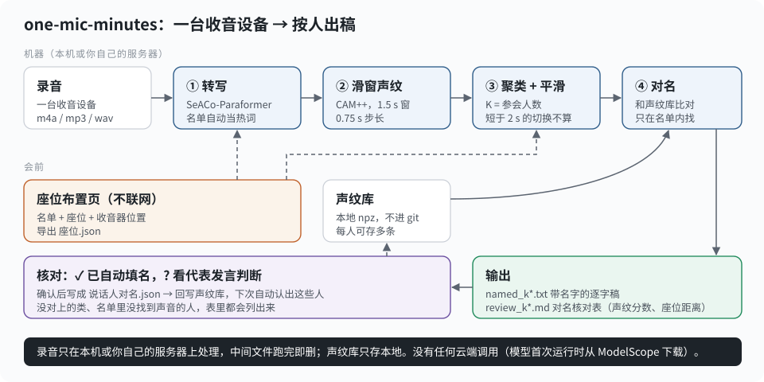
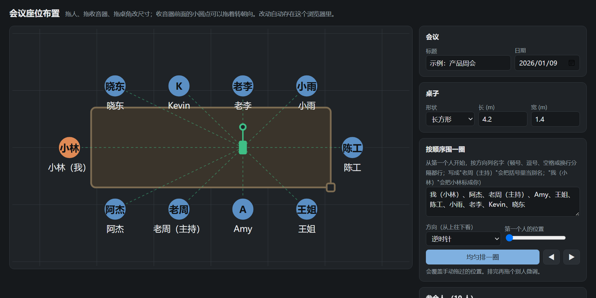

# one-mic-minutes

**一台收音设备开闭门会，会后拿到"每句话是谁说的"逐字稿和纪要。录音全程不出你的机器。**

*Who said what at a closed-door meeting with just one recorder — the attendee list and seat map steer speaker separation, a local voiceprint library auto-names regulars, and you confirm a review table before minutes are written. Chinese ASR (FunASR), fully offline.* （English summary at the bottom.）

---

十二个人围着长桌开会，桌子中间放一支录音笔。会开了一个半小时，谈的都是不能外传的内容，录音不能上传到任何云端纪要服务。会后需要一份纪要，每句话后面写明是谁说的。

这个仓库就是为这种场合写的。它在一场 97 分钟、12 人的真实会议上跑过一遍，最后 10 个人对上了声音；建好声纹库以后，再跑同一批人，基本可以自动填上名字。



## 和同类工具有什么不同

本地跑 FunASR 或 WhisperX 出会议纪要的开源项目已经不少，录音不上传这一点大家都能做到。这个仓库多做了三件事：

1. **会前的信息直接参与分人。** 名单里有几个人，就分几类；名字自动当热词；比对声纹时只在到场的人里找。座位布置页还会记下每个人离收音器有多远，核对时可以作为一项参考。多数工具只能输出"说话人 1、说话人 2"，名字要事后一个个手填。
2. **先核对，再写纪要。** 每一类声音都列出声纹分数、座位距离和一句代表发言，你确认之后才写纪要；确认过的声音会回写进声纹库。固定团队开过几次会以后，大部分名字都能自动填上。
3. **按智能体的工作方式来设计。** 附带一份 `SKILL.md`，把"要名单 → 跑脚本 → 发核对表 → 等你确认 → 写纪要 → 回写声纹库"写成固定步骤，Claude Code 可以直接用。

## 适合谁

| 适合 | 不适合 |
|---|---|
| 线下会议，**只有一台**录音笔或手机 | 线上会议（会议软件自带的账号区分更准） |
| 闭门会，录音**不能上传到外部服务** | 需要实时字幕 |
| **固定团队**：大部分人每次都来，声纹库越攒越准 | 每次都是陌生人的大会 |
| 会前能给出**参会名单**，最好再给座位 | 多台设备同时录音（目前不支持） |
| 中文为主 | 以英文为主的会（换模型能做，但没测过） |

## 快速开始

### 1. 安装

```bash
conda create -n scribe -c conda-forge python=3.11 ffmpeg
conda activate scribe
pip install torch torchaudio --index-url https://download.pytorch.org/whl/cpu
pip install -r requirements.txt
```

CPU 就够用：一场 97 分钟的会，在 32 核服务器上约 15 分钟跑完。第一次运行会从 ModelScope 下载约 2 GB 的模型（标点模型 1.2 GB、识别模型 0.95 GB）。

### 2. 先用演示录音跑通

```bash
python scripts/make_demo.py demo/demo.wav           # 用模型自带的示例音频，拼出一段 5 人轮流说话的录音
python scribe/pipeline.py demo/demo.wav demo/out --attendees examples/demo_attendees.txt
```

打开 `demo/out/review_k5.md`，能看到 5 类声音、各自的代表发言，以及"名单里还没对上声音的人"。

### 3. 跑你自己的会

```bash
python scribe/pipeline.py 录音.m4a 会议A/out --attendees 座位.json --hotwords 热词.txt
```

本机装不了环境的话，可以传到你自己的 Linux 服务器上跑，跑完结果自动取回，服务器上的文件全部删掉：

```bash
SCRIBE_HOST=myserver SCRIBE_PY='~/miniforge3/envs/scribe/bin/python' \
  bash scribe/run_remote.sh 录音.m4a 会议A 座位.json
```

## 会前：摆座位

用浏览器打开 `web/seating.html`（不联网，数据只存在你自己的浏览器里）。粘贴名单，点「均匀排一圈」，再把收音器拖到它在桌上的实际位置，然后导出 JSON。



名单里的人数会作为说话人类数，名字会自动加进热词，比对声纹时也只在名单里的人中间找。座位用来算每个人离收音器有多远，在核对时作为一项参考。

只有名单、没有座位也可以，写一个每行一个名字的 txt 就行。

## 会后：核对，然后写纪要

`review_k*.md` 长这样（示例数据）：

| 类 | 自动对名 | 声纹候选 | 座位距收音器 | 音量 | 时长 | 代表发言 |
|---|---|---|---|---|---|---|
| S0 | 老周 | ✓ 老周 0.94（次 陈工 0.61） | 1.2 m | +0.0 dB | 21.3 min | [0:03:10] 那下周先把灰度范围定下来… |
| S1 | 老周 | ✓ 老周 0.91（次 Amy 0.66） | 1.2 m | −1.8 dB | 9.7 min | [0:12:44] 行，这个你们先对一下… |
| S2 | Amy | ✓ Amy 0.89（次 小雨 0.74） | 1.1 m | −2.5 dB | 8.1 min | [0:20:05] 数据看板这周已经上线了… |
| S3 | ? | ? 陈工 0.71（次 晓东 0.68） | — | −7.9 dB | 3.2 min | [0:41:30] 供应商那边说月底才能… |
| S4 | ? | — | — | −4.0 dB | 0.9 min | [0:05:12] 对，对… |

**名单里还没对上声音的人**：陈工、晓东

- **✓** 表示声纹分数 ≥ 0.80，并且比第二名高出至少 0.05，名字已经自动填好。
- **?** 表示要你判断：看代表发言，回想会上谁点了谁的名、谁在汇报哪一块。
- 同一个人常被拆成"长段发言"和"短句接话"两类（上表的 S0、S1）；声纹对上同一个名字，就会自动合并。
- 零碎的"对 / 行"会单独聚成一类（上表的 S4）。

核对完，把结果写成 `说话人对名.json`（格式见 `examples/mapping.example.json`），然后回写声纹库：

```bash
python scribe/voiceprint.py build 会议A/out/emb.npz 会议A/out/labels_k12.npy 说话人对名.json 会议A 声纹库.npz --lib 声纹库.npz
```

下次开会带上 `--voiceprints 声纹库.npz`，这些人就能自动认出来。改了名单或声纹库，也不用重跑语音识别：

```bash
python scribe/pipeline.py - 会议A/out --reuse --attendees 座位.json --voiceprints 声纹库.npz
```

纪要本身由人来写，或者交给你常用的智能体。`skills/meeting-minutes/SKILL.md` 是一份 Claude Code 技能，按"先核对、再写纪要、最后回写声纹库"的顺序带着智能体走完流程；放进 `~/.claude/skills/` 就能用。

## 准确率：目前只有一场会的数据

下面这些数字都来自同一场会（97 分钟、12 人、单只录音笔放在桌子中间），只能作为参考：

- 说话人类数设成名单人数时，最后对上了 10 个人：有 1 个人被拆成两类，另有 1 类是零碎短句。全场说话不到半分钟的人没有找到对应的类。
- 声纹交叉验证：用前半场建库、测后半场，再反过来做一次，12 次全部认对。本人的分数在 0.89–0.98，其他人最高 0.82；陌生人不超过 0.32。
- **还没做过跨会议验证。** 换了房间、座位或设备，分数会下降。0.80 这条线只是第一版，用几次之后建议按实际分数再调。
- 音量和座位距离的对应关系只能作旁证。房间混响和每个人嗓门的大小，都会让距离和音量对不上。

## 实现

| 步骤 | 做法 |
|---|---|
| 转写 | FunASR SeACo-Paraformer + FSMN-VAD + CT-Punc，输出句级和字级时间戳，支持热词 |
| 声纹 | CAM++，在有人说话的片段上用 1.5 s 窗、0.75 s 步长逐窗提取 |
| 聚类 | 剪枝余弦亲和矩阵上做谱聚类；类数用名单人数，没有名单时用 eigengap 估计 |
| 平滑 | 相邻 ±3 窗多数投票；短于 2 s 的说话人切换不算 |
| 对名 | 每类的稳健中心（去掉离中心最远的 20% 窗）和声纹库比对，取余弦最大值；只在名单内比对 |
| 声道 | 两个声道逐样本相同（假立体声）时按单声道处理；真立体声的左右声道差会记录下来，**定位功能还没做** |

## 隐私

- 录音只在你的机器（或你自己的服务器）上处理，中间产生的音频文件跑完就删。
- 声纹属于生物识别信息。声纹库只存本地，`.gitignore` 已经排除了它；建库之前，先告诉同事并征得同意。
- 唯一的联网动作是第一次运行时从 ModelScope 下载模型。

## 路线图

- [ ] 跨会议验证声纹库，按实际分数调阈值
- [ ] 真立体声设备：用左右声道差辅助区分坐在桌子不同位置的人
- [ ] 核对表直接改名后，自动回写声纹库

## 致谢与许可

转写和声纹模型来自 [FunASR](https://github.com/modelscope/FunASR)（MIT），模型权重运行时从 [ModelScope](https://modelscope.cn) 下载，各自遵循其模型许可。本仓库代码以 MIT 许可发布。

---

## English summary

**one-mic-minutes** turns a single-recorder, in-person, closed-door meeting into a speaker-attributed transcript you can review and then write minutes from — entirely on your own machine.

- Give it the attendee list (optionally a seat map drawn in the bundled offline page). The number of attendees sets the cluster count, names become ASR hotwords, and voiceprint matching is restricted to people actually in the room.
- Pipeline: FunASR SeACo-Paraformer (Chinese ASR with hotwords) → CAM++ sliding-window speaker embeddings → spectral clustering → temporal smoothing → matching against a local voiceprint library.
- Output: a named transcript plus a review table (voiceprint score, seat distance, loudness, a representative quote per cluster). You confirm names; confirmed clusters are written back to the voiceprint library so the next meeting is mostly auto-named.
- Tested on one 97-minute, 12-person meeting: 10 people recovered; split-half voiceprint check 12/12. Cross-meeting accuracy is not yet measured.
- MIT licensed. Audio, transcripts and voiceprints are never uploaded; the only network access is the one-time model download.
